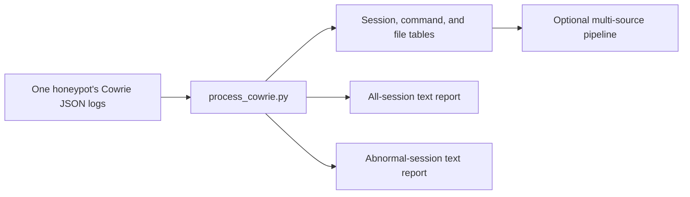
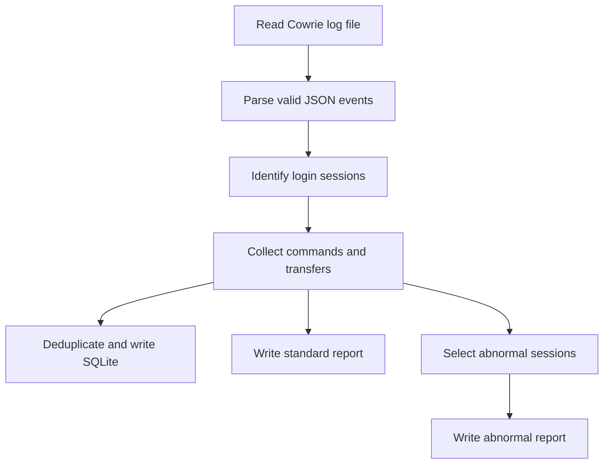

# cowrieprocessor

`process_cowrie.py` summarizes Cowrie JSON logs from a DShield or other Cowrie honeypot. It writes a SQLite database and two text reports: all processed sessions and an abnormal-session subset. The reports start with their summaries and have labeled separators before session details. The project also includes optional enrichment and upload helpers.

The original single-honeypot script remains useful on its own. For processing **multiple sensors**, enriching and combining their databases, clustering commands, and generating cross-sensor reports, see [Multi-source processing](docs/multi-source-processing.md). Those additional scripts live in the companion private [`cowrieprocessor-processing` repository](https://github.com/jslagrew/cowrieprocessor-processing), which requires access; `process_cowrie.py` by itself does not perform the cross-sensor merge. The separate [next-generation project](https://github.com/datagen24/cowrieprocessor) is another implementation.



**Prerequisites**

Use Python 3.10 or later. The script imports `requests` and `dropbox` even when optional integrations are unused. Install them in the Python environment you use to run the script:

```sh
python3 -m venv .cowrieprocessor
source .cowrieprocessor/bin/activate
python -m pip install requests dropbox
```

On Windows, use your environment's `Scripts\activate` instead. Download or clone the repository, then run commands from a writable working directory. The script defaults to `/srv/cowrie/var/log/cowrie`; use `--logpath` elsewhere.

**Using the script — arguments**

Choose a scope with `--session`, `--downloadfile`, `--ttyfile`, or `--summarizedays`, or process matching log files in the supplied log directory. `--summarizedays N` currently selects the **N most recently modified Cowrie log files**; it is not an exact event-time window. Filenames must contain `cowrie.json`.

| Argument | Purpose |
| --- | --- |
| `--logpath PATH` | Cowrie JSON log directory. |
| `--session ID` | Show a Cowrie session. |
| `--downloadfile HASH` | Find sessions associated with a downloaded file hash. |
| `--ttyfile NAME` | Find a TTY recording. |
| `--summarizedays N` | Process the N latest Cowrie log files. |
| `--accumulate` | Skip unchanged files in a persistent source database, buffer reports, and commit new rows at the end. |
| `--sourcefile PATH` | Explicit source SQLite path; useful for repeat runs and one database per sensor. |
| `--vtapi`, `--email`, `--spurapi`, `--urlhausapi` | Optional enrichment inputs for supported lookups. |
| `--dbxapi` or `--dbxkey`/`--dbxsecret`/`--dbxrefreshtoken` | Optional Dropbox upload configuration. |

**Command examples**

```sh
python process_cowrie.py --logpath /srv/cowrie/var/log/cowrie --summarizedays 2
python process_cowrie.py --logpath /srv/cowrie/var/log/cowrie --session 0123456789ab
python process_cowrie.py --logpath /srv/cowrie/var/log/cowrie --downloadfile a8460f446be540410004b1a8db4083773fa46f7fe76fa84219c93daa1669f8f2
```

For a persistent local source database:

```sh
python process_cowrie.py --logpath /path/to/cowrie/logs --accumulate --sourcefile /path/to/output/cowrieprocessor.sqlite
```

`--sourcefile` is resolved before the script changes into its timestamped report directory. Without it, the database is `cowrieprocessor.sqlite` in the starting working directory. Optional API or Dropbox arguments are supplied only when you intend to use those services; keep their values outside repository files.

**Locally created files**

Each invocation creates a timestamped report directory in the starting working directory. It contains `*_report.txt` for all selected sessions and `*_abnormal_report.txt` for the abnormal subset, plus any cached enrichment responses produced by optional lookups. The source SQLite file contains `sessions`, `commands`, `files`, and `files_processed` tables. The abnormal report summary counts only abnormal sessions, including its command-count and VirusTotal breakdowns.



**Database integrity and repeat runs**

New databases use `sessions.session` as a primary key. Existing databases without it receive a unique session index; commands use `(session, command, timestamp)` and files use `(session, hash, file_path)` unique indexes. If an older database already has duplicate or missing session IDs, processing stops for review instead of silently choosing a row. `files_processed` records filenames and modification times to skip unchanged inputs in `--accumulate` mode. Changed files can add previously unseen rows, but this is not a full replacement or correction mechanism. Session IDs are scoped to a source database; use the [multi-source merge](docs/multi-source-processing.md) when combining sensors.

For offline checks from a checkout, run `python -m unittest -v test_process_cowrie`. Inspect the actual database schema when analyzing an older export: earlier versions did not preserve all these constraints.

**Abnormal/unusual attack reports**

The script identifies uncommon command counts and recent malware submissions while processing. Its abnormal text file contains the selected sessions and a summary of that subset. The selection is a heuristic for review, not a malware verdict.

**Related tools**

`submit_vtfiles.py`, `cowrie_malware_enrichment.py`, and `update-cowrie-dshield.sh` are separate utilities in this repository. They are not invoked by `process_cowrie.py` or the multi-source pipeline. Review their command-line arguments and local configuration before using them.
