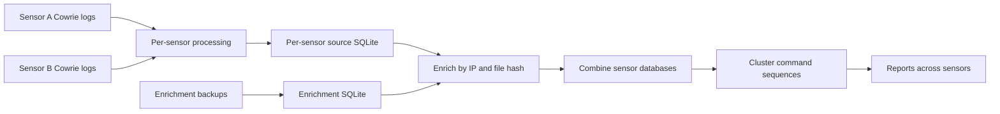
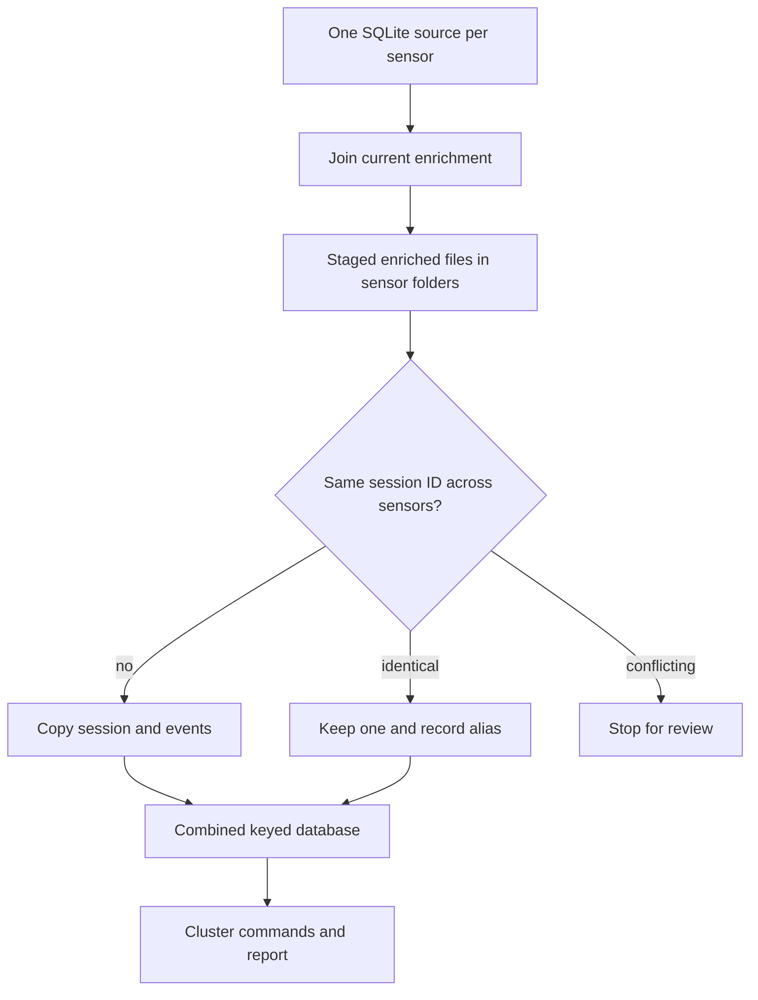

# Multi-source Cowrie processing

The single-file `process_cowrie.py` handles one log directory and one source database at a time. The companion private [`cowrieprocessor-processing` repository](https://github.com/jslagrew/cowrieprocessor-processing) adds a Windows batch launcher, a pipeline runner, and scripts for enrichment, cross-sensor merging, command clustering, and reports. Access to that repository is needed to run these examples. Its [README](https://github.com/jslagrew/cowrieprocessor-processing/blob/main/README.md) and [workflow guide](https://github.com/jslagrew/cowrieprocessor-processing/blob/main/docs/workflows.md) document every step.



## Run the complete pipeline

Keep all companion scripts beside `run_cowrie_pipeline.py` in one directory. On Windows, first check local syntax and dependencies, then run the launcher from that directory:

```bat
run_cowrieprocessor_summaries_scratch.bat --check
run_cowrieprocessor_summaries_scratch.bat --data-root "D:\honeypotdata" --backup-root "D:\Honeypot Backups" --local-output-root "D:\Cowrie Output"
```

The runner has environment-specific network-share defaults; the example overrides them with local paths. It expects an `enrichment/` folder and one log directory per configured honeypot under the data root. The current sensor list and the `azurehp2` to `azure` directory mapping are defined in `run_cowrie_pipeline.py`; edit that list for a different deployment. It processes one sensor after another, stops on a failed step, keeps numbered logs and `summary.json` under `logs/<run-id>/`, and writes `SUCCESS.txt` only after the entire pipeline finishes. Local copies are saved before NAS publication when configured. Network-share access is managed outside the scripts.

## Run the new stages individually

The commands below illustrate a small local workflow. Replace paths with your own input, enrichment, and output directories, and create the shown `D:\work` subdirectories first. Run one `process_cowrie.py` command per sensor, using a **separate** persistent source database for each. These commands assume Python is available as `python` and the scripts are in the current directory.

```bat
python process_cowrie.py --logpath "D:\honeypotdata\sensor-a\logs" --accumulate --sourcefile "D:\work\sensor-a\cowrieprocessor.sqlite"
python process_cowrie.py --logpath "D:\honeypotdata\sensor-b\logs" --accumulate --sourcefile "D:\work\sensor-b\cowrieprocessor.sqlite"
```

The enrichment builder reads `COWRIE_ENRICHMENT_ROOT` and writes a dated `YYYY-MM-DD_enrichment_data.sqlite` file in its current working directory. After it has produced that file, enrich each sensor separately:

```bat
python combine_cowrie_enrichment_sqlite.py --cowriesource "D:\work\sensor-a\cowrieprocessor.sqlite" --enrichmentsource "D:\work\2026-10-31_enrichment_data.sqlite" --destinationfile "D:\work\inputs\sensor-a\sensor-a_enriched.sqlite"
python combine_cowrie_enrichment_sqlite.py --cowriesource "D:\work\sensor-b\cowrieprocessor.sqlite" --enrichmentsource "D:\work\2026-10-31_enrichment_data.sqlite" --destinationfile "D:\work\inputs\sensor-b\sensor-b_enriched.sqlite"
```

The parent folder of each enriched file becomes its `honeypot` label in the combined `sessions` table. Keep the inputs under separate sensor-named folders, then combine and cluster:

```bat
python combine_cowrie_sqlite.py --startingpath "D:\work\inputs" --endswith "_enriched.sqlite" --outputname "D:\work\combined.sqlite"
python analyze_cowrie_v22.py --sourcefile "D:\work\combined.sqlite" --table commands --field command --aggressive-bucketing --length-bucket-size 80 --threshold 0.55 --seed 42
python report_cowrie_v12.py --sourcefile "D:\work\combined.sqlite"
```

The analyzer modifies `combined.sqlite` in place. If you need both an enriched-only and a clustered export, copy the enriched database to a distinct filename before clustering. The full runner does this for its published outputs. The report script generates text, PNG charts when `matplotlib` is installed, and workbook output when `openpyxl` is installed.



## Interpreting combined data

The current combiner uses `sessions.session` as a primary key, unique `(session, command, timestamp)` and `(session, hash, file_path)` indexes, and `session_aliases` for identical cross-sensor duplicates. A reused session ID with conflicting content stops the merge. `honeypot` labels sessions; commands and files link by session ID. The clustered output adds command-sequence hashes, templates, and a `session_commands` row for sessions with commands.

Per-sensor `latest/` source databases persist across runs. Dated combined exports are **cumulative snapshots**, so consecutive exports overlap; do not add their totals together as if they were daily increments. The filename date is the run date, not an event-time boundary. For a particular export, inspect its `sqlite_master` schema and the run's `environment.json` and `summary.json`: older exports may predate key changes, and the runner records child-script hashes rather than a Git commit SHA.
